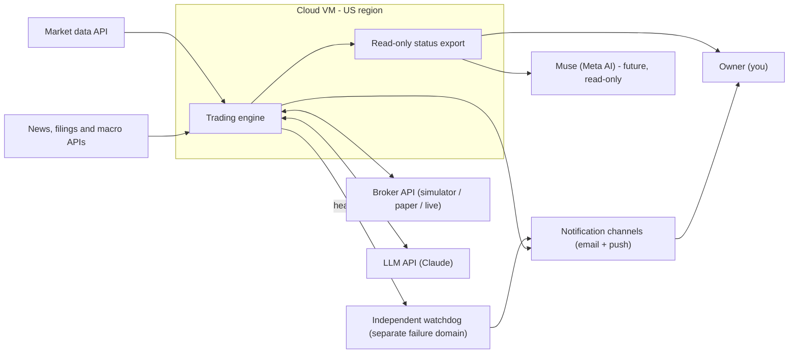
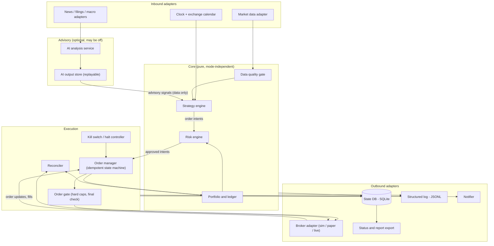
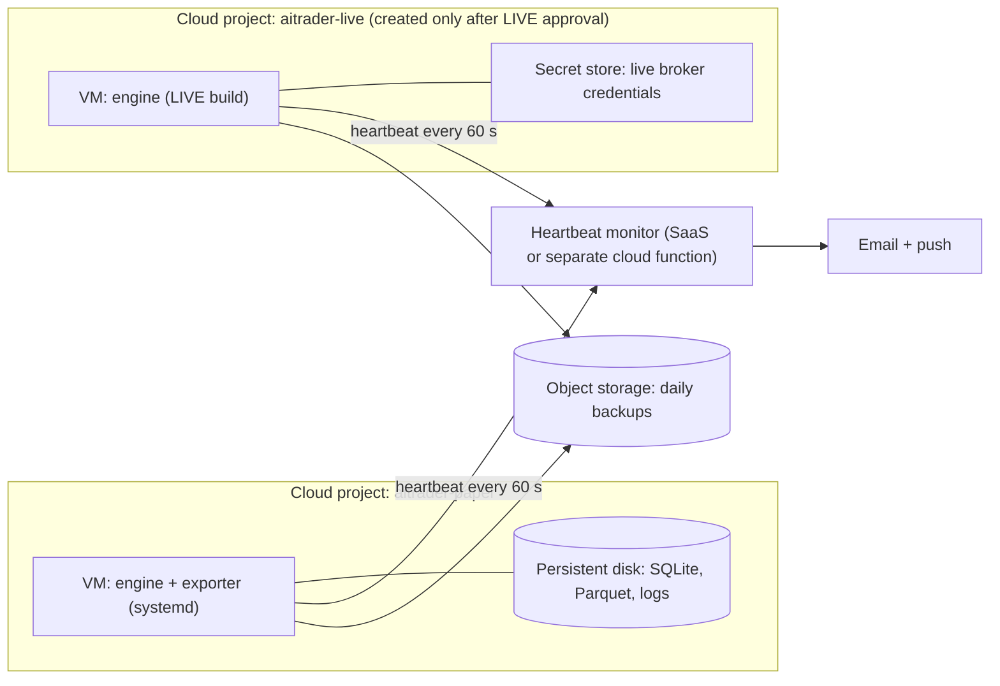
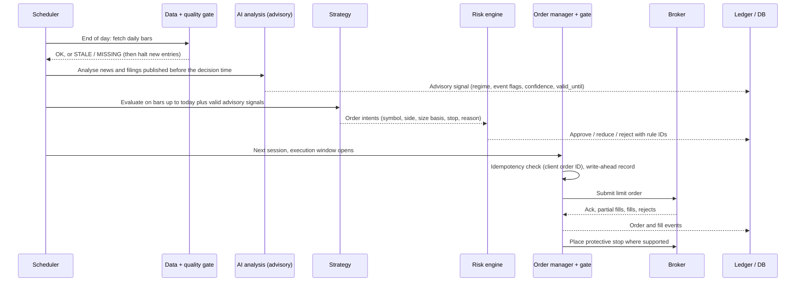

# 01. System Architecture

## 1. Goals and non-goals

**Goals**

- Fully automated trading of US-listed stocks and ETFs, running unattended during US market hours (Japanese night time).
- Three operating modes (BACKTEST, PAPER, LIVE) that share the same strategy, risk and execution code.
- AI-assisted analysis of news, earnings, macro data and market regime, with strictly bounded influence on orders.
- A path to real-money trading that needs configuration and approval, not a rewrite.
- Every decision, order, fill, error and cost is recorded and can be read from outside the system.

**Non-goals (for now)**

- High-frequency or intraday scalping strategies.
- Leverage, margin, short selling, options, crypto.
- Self-modifying strategies. Improvements are researched offline and promoted by a human-approved release.
- A graphical user interface. Reports and a read-only status interface are enough.

## 2. Architectural principles

1. **Safety before profit.** Every order passes the risk engine and a final order gate. The default answer is "no order".
2. **Fail closed.** When data is stale, state is not reconciled, the broker API misbehaves or anything is uncertain, the system stops opening new positions. Protective exit orders stay in place.
3. **Same code in every mode.** Hexagonal design ("ports and adapters"): the core never knows whether it runs in a backtest, on paper or live.
4. **Reproducibility.** Strategy and risk logic are pure functions of their inputs. Every run records the code version, configuration hash, data snapshot hash and the recorded AI outputs, so any decision can be replayed.
5. **Least privilege.** The AI component has no tool that can trade. Live credentials exist only on the live host. The status interface is read-only.
6. **Observability by default.** Everything that happens is an event in the database and in the structured log.
7. **Simplicity.** One process for trading, one for watching it. Daily-bar cadence. Few dependencies.

## 3. System context

## 4. Component view (inside the trading engine)

Rules that the diagram encodes:

- The AI service only writes **data** (advisory signals with a validity window) into a store. The strategy reads that data. No code path goes from the AI service to the order manager.
- The risk engine sees every intent before the order manager does. The order gate re-checks hard caps immediately before the broker call, so even a bug in the risk engine cannot exceed the hard limits.
- The reconciler compares local state with broker state at start-up, after every reconnect and at the end of each day. Any mismatch halts new trading.

## 5. Runtime topology

- PAPER and LIVE run in **separate cloud projects**, with separate service accounts and secrets. The paper host never holds live credentials.
- The heartbeat monitor runs outside the trading VM. If the VM, the process or the network dies, the monitor notices the missing heartbeat and alerts.
- Clock synchronisation (chrony/NTP) is mandatory; time drift is checked at start-up.

## 6. Daily operating timeline

All internal timestamps are UTC. Schedules are defined in exchange time (America/New_York) and converted with the exchange calendar, so US daylight-saving changes are handled automatically. US daylight saving time ends on 2026-11-01.

| Exchange time (ET) | JST during US DST (Mar–Nov) | JST otherwise | Job |
|---|---|---|---|
| 06:00 | 19:00 | 20:00 | Data refresh; AI pre-market analysis of news since the last close (advisory, stored with a validity window). |
| 09:20 | 22:20 | 23:20 | Pre-open checks: clock, data freshness, broker connectivity, reconciliation, halt state, kill switch. |
| 09:30 | 22:30 | 23:30 | Market opens. No orders in the first minutes (opening auction volatility). |
| 09:35–10:30 | 22:35–23:30 | 23:35–00:30 | Execute orders decided at the previous close: limit orders with a price collar; unfilled orders are cancelled at the end of the window. |
| Every 1–5 min | — | — | Risk monitor: position stops, circuit breakers, daily loss, heartbeat, broker health. |
| 16:00 | 05:00 | 06:00 | Market closes. |
| 16:20 | 05:20 | 06:20 | End of day: download daily bars, reconcile, update ledger, compute next-day signals, write daily report. |
| Weekend | — | — | Backups, maintenance window, weekly report. Deployments only happen outside market hours. |

Half-days and holidays come from the exchange calendar, not from a hand-written list.

## 7. Decision flow for one trading day

## 8. Failure domains and what happens when each fails

| Failure | Detection | Automatic reaction |
|---|---|---|
| AI API down, slow or invalid output | Timeout, schema validation | Strategy runs without the AI overlay (rule-based baseline). Alert if repeated. |
| Market data stale or missing | Freshness and completeness checks | No new entries. Existing protective orders stay. Alert. |
| Broker API errors or disconnect | Error counters, heartbeat to broker | DEGRADED state: no new entries, retry with backoff, reconcile after reconnect. |
| Engine process crash | systemd restart; missing heartbeat | Restart into SAFE mode: reconcile before any trading. |
| Whole VM down | External heartbeat monitor | Alert by email and push. Broker-side stop orders (where supported) keep protecting positions. |
| Local database corruption | Integrity check at start-up | Refuse to trade; restore from backup; reconcile from broker. |
| Clock drift | Drift check against NTP | Refuse to trade above a drift threshold. |
| Bad deployment | Pre-deploy test gate; version pinned per run | Roll back to the last known good release. Deploy only outside market hours. |

## 9. Security boundaries

- Secrets are never committed. Paper and live secrets live in different secret stores, in different cloud projects.
- The trading VM accepts no inbound connections from the internet (SSH only via the cloud provider's identity-aware tunnel or a private network such as Tailscale).
- The status export contains no secrets and no full account numbers (masked).
- News text and other external content are treated as untrusted data. The AI service runs without tools that act on the outside world; its output must match a strict schema with bounded values.
- Dependencies are pinned with hashes (lock file); updates go through review and the full test suite.

## 10. Mapping requirements to architecture

| Requirement (from the brief) | Where it is handled |
|---|---|
| Three modes, shared strategy and risk code | Document 04, section 4 of this document |
| Broker-specific code is a replaceable adapter | `broker` package, document 03 |
| LIVE disabled, multi-condition activation | LiveGuard, document 04 |
| AI cannot place unlimited orders | Advisory-only design, document 11; order gate, document 05 |
| Risk management independent of AI | Import rules and order gate, documents 03 and 05 |
| Safe recovery, reconciliation, kill switch | Documents 05 and 13 |
| Unattended cloud operation, monitoring, Muse-ready interface | Document 13 |
| Separate accounting of trading P&L and operating costs | Ledger design, documents 03 and 08 |
