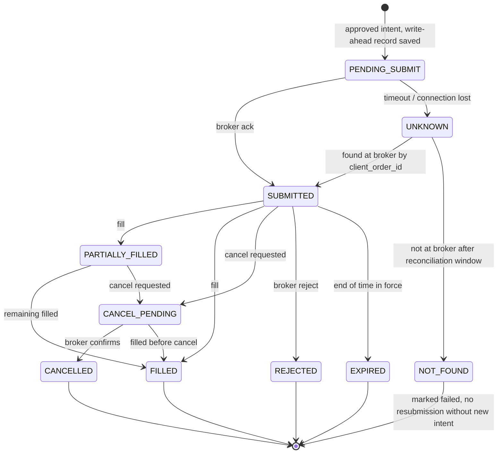

# 03. Python Module Design

The system is one Python package, `aitrader`, organised as ports and adapters. The core (domain, strategy, risk, portfolio) has no I/O. Everything that talks to the outside world is an adapter behind an interface, so BACKTEST, PAPER and LIVE differ only in which adapters are wired in.

Signatures below are design contracts, not final code. Codex implements them; names may be refined in review.

## 1. Repository layout

```
AI-Trader/
├── pyproject.toml              # uv-managed, pinned dependencies
├── uv.lock
├── config/
│   ├── base.yaml               # shared defaults
│   ├── backtest.yaml
│   ├── paper.yaml
│   └── live.example.yaml       # template only; the real live file never enters git
├── src/aitrader/
│   ├── domain/                 # value objects and enums (no I/O)
│   ├── config/                 # settings schema, loading, hard caps
│   ├── clock/                  # Clock port, SimClock, WallClock, exchange calendar
│   ├── data/                   # MarketData port, adapters, quality gate, Parquet store
│   ├── news/                   # News/filings/macro ports and adapters
│   ├── ai/                     # AI analysis service, LLM port, prompt templates, output store
│   ├── strategy/               # Strategy interface and implementations
│   ├── risk/                   # Risk engine, sizing, limits, circuit breakers, halt state
│   ├── execution/              # Order manager, order state machine, order gate
│   ├── broker/                 # Broker port and adapters
│   │   ├── port.py             # BrokerPort, capabilities, domain error types
│   │   ├── sim/                # SimBroker (BACKTEST, PAPER) with broker cost profiles
│   │   ├── webull/             # Webull JP adapter: the ONLY place that imports the Webull SDK
│   │   └── contract_tests/     # Broker-agnostic contract test suite (run against sim and sandbox)
│   ├── portfolio/              # Ledger: positions, cash by currency, P&L, operating costs
│   ├── reconcile/              # Local-vs-broker reconciliation
│   ├── backtest/               # Event loop, fill models, cost models, walk-forward runner
│   ├── metrics/                # Performance and cost metrics, benchmark comparison
│   ├── ops/                    # Runner, scheduler, heartbeat, kill switch, status export
│   ├── notify/                 # Notifier port and adapters
│   ├── storage/                # SQLite repositories and migrations
│   ├── app/                    # Composition root: builds the object graph per mode
│   └── cli/                    # typer commands
├── watchdog/                   # Separate, minimal program (own dependencies)
├── tests/
│   ├── unit/
│   ├── property/               # hypothesis tests for risk and ledger invariants
│   ├── integration/            # adapters against recorded/mocked HTTP
│   ├── fault/                  # fault injection: crashes, timeouts, stale data, duplicates
│   └── fixtures/               # small CSV/Parquet data sets, recorded API responses
├── docs/
└── .github/workflows/ci.yml
```

## 2. Package responsibilities

| Package | Responsibility | Must not |
|---|---|---|
| `domain` | Immutable types: `Instrument`, `Bar`, `Quote`, `Money` (Decimal + currency), `OrderIntent`, `Order`, `Fill`, `Fee`, `FxConversion`, `Position`, `AdvisorySignal`, `RiskDecision`, enums (`Mode` = BACKTEST/PAPER/LIVE, `BrokerEnvironment` = SIM/WEBULL_SANDBOX/WEBULL_LIVE, `Side`, `OrderType`, `TimeInForce`, `OrderStatus`, `HaltReason`). | Import anything outside the standard library and pydantic. |
| `config` | Load YAML + environment, validate with pydantic, compute a config hash, enforce **hard caps** (compiled-in ceilings that config cannot exceed). | Read secrets into logs. |
| `clock` | `Clock` port (`now()`, `sleep_until()`), `SimClock` for backtests, `WallClock` for paper/live, exchange sessions via `exchange_calendars`. | Use `datetime.now()` anywhere else (enforced by lint rule). |
| `data` | `MarketDataProvider` port; adapters (`csv_replay`, `parquet_store`, `alpaca_data`, later broker data); `DataQualityGate`. | Return data with timestamps later than `clock.now()` (look-ahead guard). |
| `news` | `NewsSource`, `FilingSource`, `MacroSource` ports; normalisation with `published_at`, `retrieved_at`, source and hash. | Pass raw HTML to the AI service without sanitising. |
| `ai` | Build the sanitised **input bundle** and publish it to the data repository; fetch, schema-validate and store the **advisory file** written by the Claude Code scheduled task; keep the prompt templates and schemas (versioned, `ai/prompts/`, `ai/schemas/`); replay stored advisories in backtests; optional pay-as-you-go API client (fallback mode, only after approval) with the USD 10/month cap. | Import `execution`, `broker` or `risk`. Put account data, positions or credentials into the bundle. Hold any credential except the data-repository token (and the API key in fallback mode). |
| `strategy` | Pure functions: given bars, portfolio snapshot and valid advisory signals, return `OrderIntent`s with reasons. Versioned parameters. | Perform I/O, read the clock directly, or import `ai`. |
| `risk` | Pre-trade checks, position sizing with fees, portfolio limits, loss limits, circuit breakers, halt state machine. | Import `ai`. Depend on anything non-deterministic. |
| `execution` | Order manager (idempotent submission, state machine, write-ahead records, cancel/replace, protective stops); `OrderGate` (final hard-cap check). | Import `ai`. Submit without an approved `RiskDecision`. |
| `broker` | `BrokerPort` and adapters (`sim`, `webull`); environment allow-lists (endpoints, account IDs); translate broker payloads and errors to domain types; broker cost profiles; a broker-agnostic contract test suite. | Import `ai`. Contain strategy logic. Leak SDK types outside the adapter. |
| `portfolio` | Double-entry ledger: cash per currency (USD, JPY), settled vs unsettled cash, positions, realised/unrealised P&L, fees, FX, dividends, **operating costs in a separate account**. | Mix trading P&L with operating costs. |
| `reconcile` | Compare local orders/positions/cash with the broker; produce a report; set HALT on mismatch. | Auto-"fix" mismatches silently. |
| `backtest` | Event loop over historical data with `SimClock`; fill, spread, slippage, partial-fill and fee models; walk-forward orchestration; run manifest. | Use a different strategy or risk code path than paper/live. |
| `metrics` | Returns (daily, monthly, yearly), drawdown, Sharpe, Sortino, profit factor, win rate, payoff ratio, exposure, turnover, benchmark comparison, cost attribution. | — |
| `ops` | Runner (main loop), scheduler, heartbeat sender, kill-switch watcher, status/report export, start-up SAFE mode. | — |
| `notify` | `Notifier` port; email and webhook adapters; severity routing; rate limiting of alerts. | — |
| `storage` | Repositories over SQLite; migrations; integrity check; backup/restore helpers. | — |
| `app` | Composition root: `build_system(mode, config) -> System`. The only place where mode-specific adapters are chosen. | Contain business logic. |
| `watchdog` (top level) | Independent program: checks heartbeats and status freshness, sends alerts, can trigger the kill switch. | Import `aitrader` internals beyond a tiny shared schema. |

## 3. Dependency rules (checked in CI with import-linter)

```
domain        <- everything may import domain
config, clock <- may import domain
strategy      -> domain only
risk          -> domain, config
portfolio     -> domain
execution     -> domain, risk (types only), portfolio, broker (port only)
broker        -> domain, config
ai            -> domain, config, news (port), storage (port)
app           -> everything (composition root)

FORBIDDEN:
  risk, execution, broker, portfolio, reconcile  -X->  ai
  strategy                                       -X->  ai, broker, data adapters, storage
  any package except app and cli                 -X->  concrete adapters of another package
  any package except aitrader.broker.webull      -X->  webull (the Webull SDK)
```

`AdvisorySignal` is a plain domain type. The strategy receives a list of these values; it never calls the AI service.

## 4. Core interfaces (design contracts)

```python
# domain (selected)
class OrderIntent(BaseModel, frozen=True):
    intent_id: str                 # deterministic: hash(strategy_id, version, symbol, side, signal_ts, seq)
    strategy_id: str
    strategy_version: str
    symbol: str
    side: Side                     # BUY or SELL (no short selling: SELL only reduces a long)
    target_notional: Money | None  # sizing basis; risk engine computes final quantity
    target_quantity: Decimal | None
    limit_price: Decimal | None
    stop_price: Decimal            # mandatory for entries
    reason: str                    # human-readable, stored for audit
    signal_ts: datetime            # bar timestamp the decision used
    advisory_ids: tuple[str, ...]  # AI signals that influenced it (may be empty)

class RiskDecision(BaseModel, frozen=True):
    intent_id: str
    verdict: Literal["APPROVE", "REDUCE", "REJECT"]
    approved_quantity: Decimal
    rule_results: tuple[RuleResult, ...]   # every rule ID with pass/fail and numbers
    limits_hash: str

# ports
class Clock(Protocol):
    def now(self) -> datetime: ...                    # always timezone-aware UTC

class MarketDataProvider(Protocol):
    def daily_bars(self, symbols: Sequence[str], start: date, end: date) -> BarFrame: ...
    def latest_quote(self, symbol: str) -> Quote: ...

class BrokerPort(Protocol):
    environment: BrokerEnvironment                    # SIM, PAPER, LIVE
    def account(self) -> AccountSnapshot: ...         # cash, buying power, account id, is_paper
    def positions(self) -> list[BrokerPosition]: ...
    def open_orders(self) -> list[BrokerOrder]: ...
    def submit(self, order: OrderRequest) -> BrokerOrderAck: ...      # idempotent on client_order_id
    def cancel(self, client_order_id: str) -> None: ...
    def order_status(self, client_order_id: str) -> BrokerOrder: ...
    def fills_since(self, ts: datetime) -> list[BrokerFill]: ...
    def capabilities(self) -> BrokerCapabilities: ... # fractional, stop types, TIF, extended hours

class Strategy(Protocol):
    strategy_id: str
    version: str
    def evaluate(self, ctx: StrategyContext) -> list[OrderIntent]: ...  # pure

class RiskEngine(Protocol):
    def evaluate(self, intent: OrderIntent, state: RiskState) -> RiskDecision: ...  # pure

class LlmClient(Protocol):
    def analyse(self, request: AnalysisRequest) -> AnalysisResponse: ...

class Notifier(Protocol):
    def send(self, alert: Alert) -> None: ...
```

## 5. Order manager state machine



Key rules:

- The order record (with `client_order_id`) is written to the database **before** the broker call. After a crash, the record tells the reconciler what may exist at the broker.
- `UNKNOWN` never leads to an automatic resubmission. The system first asks the broker by `client_order_id`.
- The same `intent_id` can produce at most one live order at a time (unique index in the database).

## 5a. Webull adapter (`aitrader.broker.webull`)

The adapter is the only code that knows Webull exists. It implements `BrokerPort` using the **official Python SDK** (`webull-openapi-python-sdk`, exact version pinned in the lock file). Replacing Webull with another broker means writing another package that implements the same port and passes the same contract tests.

| Component | Job |
|---|---|
| `client.py` | Builds SDK clients (`ApiClient`, `TradeClient`, events client, data client) for one `BrokerEnvironment`; checks hosts against the allow-list; sets the token directory; sets explicit timeouts. |
| `orders.py` | Maps `OrderRequest` → Webull fields and back (table below); preview before place; submit; replace; cancel; lookup by `client_order_id`. |
| `events.py` | gRPC order-event listener; heartbeat (`Ping`) watchdog; fallback to polling; maps scene types to order-manager events. |
| `accounts.py` | Account list (verifies approved account ID and `CASH` type), balances per currency, positions. |
| `market_data.py` | LIVE only: snapshots, bars and MQTT streaming with re-subscribe on reconnect. |
| `auth.py` | Token status and `expires_at` checks, App Key expiry tracking, mapping of auth failures to AUTH-* rules. Token **creation** is a separate owner-run CLI command. |
| `fees.py` | Reads `commission` and `fees[]` from order detail into `trade_costs`; falls back to the `webull_jp` cost model when not yet reported. |
| `errors.py` | Known error-code table → domain errors and ORD-ERR-* actions; unknown codes → ORD-ERR-2. |

Field mapping for US stock orders:

| Domain field | Webull field | Rule |
|---|---|---|
| `client_order_id` | `client_order_id` | ≤ 32 chars, `[A-Za-z0-9_-]` (document 05, DUP-2) |
| side BUY / SELL | `side` | `SHORT` never sent (HC-10) |
| order type | `order_type` | `LIMIT` (marketable, with price cap) by default; `MARKET` only for emergency exits; `STOP_LOSS`/`STOP_LOSS_LIMIT` only for whole-share positions once verified |
| quantity or notional | `entrust_type` + `quantity` or `total_cash_amount` | Fractional buy by amount (`AMOUNT`, ≥ USD 1) or decimal quantity (step 0.00001); whole shares for non-`fractionable` symbols |
| — | `instrument_type`, `market`, `combo_type` | `EQUITY`, `US`, `NORMAL` |
| — | `support_trading_session` | `CORE` |
| time in force | `time_in_force` | `DAY` for entries and exits |
| — | `account_tax_type` | From approved config (`SPECIFIC` or `GENERAL`) |

Operational rules: SDK retries are not relied on for POST requests; a timeout makes the order `UNKNOWN` and triggers a lookup. The SDK token file lives in a dedicated 0700 directory outside the repository. Sandbox endpoints are accepted only by the contract-test command.

## 6. Data model (SQLite tables, first version)

| Table | Purpose | Key columns |
|---|---|---|
| `runs` | One row per process start or backtest run | run_id, mode, git_commit, config_hash, data_snapshot_hash, started_at, ended_at |
| `heartbeats` | Liveness | run_id, ts, state (RUNNING / DEGRADED / HALTED / SAFE) |
| `bars` (or Parquet) | Market data used for decisions | symbol, ts, o/h/l/c/v, source, ingest_ts |
| `advisory_signals` | AI outputs with provenance | advisory_id, kind, payload_json, source (scheduled_task / api), model_id, prompt_version, input_bundle_hash, created_at, valid_from, valid_until, cost_usd (0 on subscription) |
| `intents` | Strategy outputs | intent_id, strategy_id, version, payload_json, signal_ts |
| `risk_decisions` | Risk verdicts | intent_id, verdict, approved_qty, rule_results_json, limits_hash |
| `orders` | Order life cycle | client_order_id, intent_id, broker_order_id, status, request_json, updated_at |
| `order_events` | Append-only order history | client_order_id, ts, event, payload_json |
| `fills` | Executions (Webull reports order-level aggregates; partial fills come from events) | fill_id, client_order_id, qty, price, ts, source (event / order-detail / sim) |
| `trade_costs` | Every trading cost, one row per item | ts, client_order_id, type (COMMISSION, CAT_FEE, FINRA_FEE, SEC_FEE, ADR_FEE, OTHER), amount, currency, actual_or_estimated, source (broker breakdown / cost model) |
| `fx_conversions` | Every JPY⇄USD conversion | ts, jpy_amount, usd_amount, applied_rate, reference_rate, spread_cost_jpy, source (statement / manual entry) |
| `positions_snapshots` | End-of-day and on-change snapshots | ts, symbol, qty, avg_cost, market_value |
| `cash_ledger` | Double-entry cash movements | entry_id, ts, account (CASH_USD, CASH_JPY, FEES, FX, DIVIDENDS, ...), amount, currency, ref |
| `operating_costs` | AI, server, data, other costs | ts, category (AI / SERVER / DATA / OTHER), provider, amount, currency, ref |
| `equity_curve` | Daily equity | date, equity_usd, equity_jpy, fx_rate, trading_pnl, operating_costs |
| `risk_events` | Rule breaches, circuit breakers | ts, rule_id, severity, details_json |
| `halts` | Halt state transitions | ts, from_state, to_state, reason, actor (system / owner) |
| `reconciliations` | Results | ts, scope, status, diff_json |
| `incidents` | Anything needing attention | incident_id, ts, severity, summary, status |

All monetary values are stored as decimal strings with an explicit currency. All timestamps are UTC ISO-8601.

## 7. Configuration

- `config/base.yaml` holds defaults; mode files override them; environment variables override files (for secrets only, never for limits).
- Secrets come from environment variables or a secret store, are wrapped in `SecretStr`, and are never logged.
- Every run logs the config hash. Changing any risk limit changes the hash and is visible in reports.
- **Hard caps** (for example: maximum order notional, maximum gross exposure = 100% of equity, no short selling, no leverage) are constants in code. A config value above a hard cap is a start-up error, not a warning. Raising a hard cap requires a code change, review and owner approval.

## 8. Error handling conventions

- Domain errors are typed (`StaleDataError`, `BrokerUnavailableError`, `RiskRejection`, `ReconciliationMismatch`, ...). No bare `except`.
- Every external call has an explicit timeout. Retries only for idempotent operations, with exponential backoff and jitter, and a retry budget.
- After N consecutive failures of the same kind, the system changes state (DEGRADED or HALTED) instead of retrying forever.

## 9. Testing strategy per package

| Package | Test focus |
|---|---|
| `risk` | Every rule has unit tests at, just below and just above its threshold; property tests (no approved order ever breaks a hard cap; fees are always included). |
| `portfolio` | Property tests: ledger always balances; cash never negative in a cash account; P&L and operating costs reconcile to equity. |
| `execution` | State machine transitions; duplicate intent; crash between write-ahead and broker call; timeout → UNKNOWN → found / not found. |
| `strategy` | Golden tests on fixture data: same bars → same intents. |
| `backtest` | No look-ahead (a bar dated t+1 is never visible at t); fill model edge cases (gaps through stops, partial fills, half-days). |
| `broker` adapters | Recorded HTTP responses; error mapping; environment allow-list rejects wrong endpoints/accounts. |
| `app` | Mode wiring: PAPER build can never construct a LIVE adapter; LIVE build refuses to start without all gates. |
| Fault tests | Kill the process mid-order, drop network, return stale data, return malformed broker responses, clock jump. |
