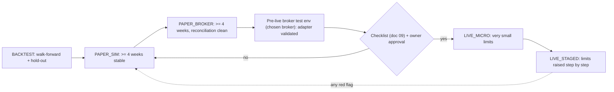

# 04. BACKTEST / PAPER / LIVE Switching Design

## 1. Principle

The mode decides **which adapters are wired in**. It never changes strategy logic, risk rules or order handling. The composition root (`aitrader.app.build_system`) is the only place that reads the mode.

## 2. Mode matrix

| Component | BACKTEST | PAPER_SIM | PAPER_BROKER | LIVE |
|---|---|---|---|---|
| Clock | `SimClock` (advances through history) | `WallClock` | `WallClock` | `WallClock` |
| Market data | Historical Parquet/CSV replay | Live data API | Live data API | Live broker data (or approved feed) |
| News / filings | Historical store (timestamped) | Live sources | Live sources | Live sources |
| AI analysis | **Replay** of recorded outputs, or OFF | Live calls (budget-capped) or OFF | Live calls or OFF | Live calls or OFF |
| Strategy | same | same | same | same |
| Risk engine | same | same | same | same (LIVE limit file) |
| Order manager + order gate | same | same | same | same |
| Broker adapter | `SimBroker` with historical fill model | `SimBroker` with live quotes | Broker paper/test endpoint (e.g. Alpaca paper) | Live broker endpoint |
| Database | `data/backtest/<run_id>.db` | `data/paper_sim/state.db` | `data/paper_broker/<broker>/state.db` | `data/live/<broker>/state.db` on the live host |
| Credentials | none | data API key | paper keys | live keys (live host only) |
| Capital | config | virtual capital cap (same size as planned live) | virtual capital cap (broker paper balance is ignored above the cap) | real balance, capped by live limits |

PAPER_SIM and PAPER_BROKER are both "PAPER" in the brief. They are kept separate because they test different things: PAPER_SIM tests the logic with live data and our own fill model; PAPER_BROKER tests the real order life cycle of an external system.

**Virtual capital cap:** paper accounts often start with large balances (Alpaca: USD 100k). The ledger enforces a configured capital cap (for example ¥50,000 equivalent) so that sizing, fees and minimum-order effects match the planned live account.

## 3. Composition root

```python
def build_system(mode: Mode, cfg: Settings) -> System:
    clock   = SimClock(cfg.backtest.start) if mode is Mode.BACKTEST else WallClock()
    data    = select_market_data(mode, cfg)        # replay or live adapter
    broker  = select_broker(mode, cfg)             # SimBroker / PaperBroker / LiveBroker
    if mode is Mode.LIVE:
        LiveGuard(cfg, broker).assert_all_gates()  # raises and exits on any failure
    risk    = RiskEngine(cfg.risk_limits_for(mode))
    oms     = OrderManager(broker, OrderGate(HARD_CAPS, cfg.risk_limits_for(mode)), storage)
    ...
    return System(clock, data, strategies, risk, oms, ledger, reconciler, notifier)
```

`select_broker` uses an explicit allow-list per mode. A PAPER build has no code path that can return a LIVE adapter: LIVE adapters live in a separate module that is imported only inside the `Mode.LIVE` branch, and an integration test asserts that building PAPER never imports it.

## 4. LiveGuard: the gates for LIVE

LIVE starts only if **all** gates pass. Each failure stops the process with a clear message and an alert.

| Gate | Check | Evidence |
|---|---|---|
| G1 Owner approval | A signed approval record `live_approval.yaml` exists on the live host: owner name, date, approved broker, account ID (masked + hash), approved limits hash, expiry date. Approval expires (for example after 90 days) and must be renewed. | File content hash logged at start-up |
| G2 Separate environment | Process runs on the live host (cloud project ID / machine ID matches the approval); environment variable `AITRADER_ENV=live`; database path is the live path. | Host identity logged |
| G3 Separate credentials | Live credentials are loaded only from the live secret store; their names carry the `LIVE_` prefix; paper credentials are absent. | Secret source logged (never the value) |
| G4 Endpoint and account match | Broker endpoint URL is on the live allow-list; the account returned by the API matches the approved account ID hash; the API reports a real-money account (where the API exposes it); account type is cash (no margin). | Account snapshot (masked) |
| G5 Tests passed | The running git commit has a passing CI result for the full suite including fault tests, recorded in a release manifest. | Manifest with commit SHA and CI run ID |
| G6 Live limits | `live_limits.yaml` exists, is within hard caps, and its hash equals the approved limits hash. Includes max order notional, max total holdings, daily and monthly loss limits. | Limits hash |
| G7 Safety self-test | At start-up: kill switch read/write works, reconciliation with the broker returns no mismatch, notifier delivers a test alert, clock drift is within limit. | Self-test report |

There is no "force" flag. To bypass a gate the code must be changed, reviewed and approved.

## 5. Promotion path



Durations are minimums. Promotion is never automatic: each arrow needs a review by Claude and approval by the owner.

## 6. Environment separation in practice

| Concern | PAPER | LIVE |
|---|---|---|
| Cloud project | `aitrader-paper` | `aitrader-live` (created only after approval) |
| Service account | paper-only | live-only |
| Secret names | `PAPER_*`, `DATA_*`, `LLM_*` | `LIVE_*`, `DATA_*`, `LLM_*` |
| Config files | `config/paper.yaml` | `live_limits.yaml`, `live_approval.yaml` (not in git) |
| Database | paper path | live path; backups encrypted |
| Who can deploy | CI after merge | Manual deploy by the owner's operator after approval |

## 7. What the same-code rule prevents (and how it is tested)

| Risk | Test |
|---|---|
| Strategy behaves differently in paper and backtest | **Parity test:** record the bars a PAPER_SIM day used; replay them in BACKTEST; the intents must be identical. |
| Risk limits differ silently between modes | Limits are loaded through one function; tests compare the effective limits per mode against the documented table. |
| Paper code reaches a live endpoint | Endpoint allow-list unit tests; build-time import test; LIVE adapter refuses to start without `AITRADER_ENV=live`. |
| Live code uses paper credentials | Credential prefix check in G3. |
| Fill model too optimistic in backtest | Compare PAPER_BROKER fills against SimBroker shadow fills on the same orders; track the gap as a metric. |

## 8. Switching procedure (operator view)

1. `aitrader backtest --config config/backtest.yaml` — any time, no credentials needed (Phase 1).
2. `aitrader paper --sim` — needs a market data key (Phase 3).
3. `aitrader paper --broker alpaca` — needs paper keys (Phase 3).
4. `aitrader live` — only on the live host; refuses to run unless LiveGuard passes (Phase 7; disabled until then).

The `live` command exists from the start but its adapter module is empty until the live broker is chosen, so no one can "accidentally" trade real money during development.
