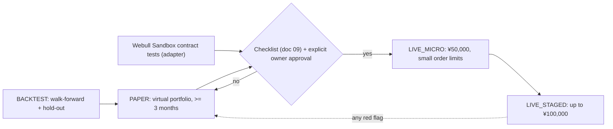

# 04. Environment Separation: BACKTEST / PAPER / LIVE (+ Webull Sandbox tests)

## 1. Principle

There are exactly **three operating environments**. The environment decides **which adapters are wired in**; it never changes strategy logic, risk rules or order handling. The composition root (`aitrader.app.build_system`) is the only place that reads it.

| Environment | Purpose | Broker side | Money |
|---|---|---|---|
| **BACKTEST** | Validate strategies on historical data | `SimBroker` with the historical fill model | none |
| **PAPER** | Run the full system continuously on live market data with a **dedicated virtual portfolio** | `SimBroker` with the live fill model and the Webull cost profile; our ledger is the portfolio | virtual |
| **LIVE** | Future real-money trading through the Webull production API | `WebullBroker(environment=WEBULL_LIVE)` | real — **disabled** |

The **Webull Sandbox** is not an operating environment. It is a **test target** for the Webull adapter (connection, signing, order placement/replace/cancel, events, error mapping). It uses Webull's shared public test accounts, whose orders and positions change at any time (document 14), so it never holds a portfolio and its results never enter P&L.

## 2. Wiring matrix

| Component | BACKTEST | PAPER | Sandbox contract tests | LIVE |
|---|---|---|---|---|
| Clock | `SimClock` | `WallClock` | `WallClock` | `WallClock` |
| Market data | Historical Parquet replay | Read-only data source (proposed: Alpaca data, Q2) | Sandbox endpoints (if available) | Webull production market data |
| News / filings | Historical, timestamped | Live sources | — | Live sources |
| AI analysis | Replay of recorded outputs, or OFF | Live (budget-capped) or OFF | — | Live or OFF |
| Strategy, risk engine, order manager, order gate | same | same | same order manager and gate (strategy not involved) | same (LIVE limit file) |
| Broker adapter | `SimBroker` | `SimBroker` | `WebullBroker(WEBULL_SANDBOX)` | `WebullBroker(WEBULL_LIVE)` |
| Cost model | Broker profile (default `webull_jp`) | `webull_jp` | Webull's actual responses | Webull's actual fees |
| Database | `data/backtest/<run_id>.db` | `data/paper/state.db` | `data/sandbox/<test_run>.db` (discarded) | `data/live/webull/state.db` on the LIVE host |
| Credentials | none | data-source key | public sandbox test keys (env variables) | Webull production App Key/Secret + token, LIVE host only |
| Capital | config | virtual capital (¥50,000 equivalent by default) | n/a | real balance, capped by the approved capital (¥50,000 start, ¥100,000 hard cap) |
| Who may run it | anyone (CI included) | the PAPER host | the operator, on request (Q10) | the LIVE host only, after approval |

## 3. Enumerations

```python
class Mode(Enum):                 # operating environment
    BACKTEST = "backtest"
    PAPER = "paper"
    LIVE = "live"

class BrokerEnvironment(Enum):    # where orders go
    SIM = "sim"                   # our SimBroker (BACKTEST, PAPER)
    WEBULL_SANDBOX = "webull_sandbox"   # contract tests only
    WEBULL_LIVE = "webull_live"         # LIVE only
```

Allowed combinations are fixed in code: `BACKTEST→SIM`, `PAPER→SIM`, `LIVE→WEBULL_LIVE`. `WEBULL_SANDBOX` is reachable only from the contract-test command, never from `aitrader paper`. Any other combination is a start-up error.

## 4. Composition root

```python
def build_system(mode: Mode, cfg: Settings) -> System:
    clock  = SimClock(cfg.backtest.start) if mode is Mode.BACKTEST else WallClock()
    data   = select_market_data(mode, cfg)          # replay, read-only data source, or Webull (LIVE)
    broker = select_broker(mode, cfg)               # SimBroker, or WebullBroker(WEBULL_LIVE)
    if mode is Mode.LIVE:
        LiveGuard(cfg, broker).assert_all_gates()   # exits on any failure
    risk   = RiskEngine(cfg.risk_limits_for(mode))
    oms    = OrderManager(broker, OrderGate(HARD_CAPS, cfg.risk_limits_for(mode)), storage)
    ...
```

The Webull adapter module (`aitrader.broker.webull`) is imported only in the LIVE branch and in the sandbox test command. An integration test asserts that building BACKTEST or PAPER never imports it.

## 5. Endpoint allow-lists (Webull)

| Broker environment | Allowed hosts (from Webull docs, re-checked in sandbox test SB-6) |
|---|---|
| `WEBULL_SANDBOX` | `jp-openapi-alb.uat.webullbroker.com` (trading, data), `jp-openapi-events.uat.webullbroker.com` (events), `data-api.uat.webullbroker.com` (MQTT) |
| `WEBULL_LIVE` | `api.webull.co.jp` (trading, data), `events-api.webull.co.jp` (events), `data-api.webull.co.jp` (MQTT) |

The adapter refuses to start if any configured host is not in the allow-list of its environment. Sandbox hosts are never accepted in LIVE and production hosts never in the sandbox.

## 6. LiveGuard: gates for LIVE

LIVE starts only if **all** gates pass. Each failure stops the process with a clear message and an alert. There is no "force" flag.

| Gate | Check |
|---|---|
| G1 Owner approval | Approval record `live_approval.yaml` on the LIVE host: owner name, date, broker (`webull_jp`), account ID hash, approved capital (≤ ¥100,000), approved limits hash, expiry (e.g. 90 days). Expired → refuse. |
| G2 Separate environment | Runs on the LIVE host (cloud project and machine ID match the approval); `AITRADER_ENV=live`; LIVE database path. |
| G3 Separate credentials | Webull production App Key/Secret come only from the LIVE secret store, with `LIVE_` names; the SDK token directory is the LIVE-only path; no paper or sandbox credentials present. |
| G4 Endpoint and account | Hosts on the `WEBULL_LIVE` allow-list; `account_list` returns exactly the approved account ID; `account_type == CASH`; tax type matches config (`SPECIFIC` or `GENERAL`). |
| G5 Authentication health | Token status `NORMAL` (when 2FA is enabled) with `expires_at` beyond the safety margin; App Key expiry date recorded and more than 7 days away; IP allow-list confirmed in the checklist. |
| G6 Tests and limits | Release manifest shows green CI (unit, property, fault) **and** a passing sandbox contract-test run for the pinned SDK version; `live_limits.yaml` within hard caps and matching the approved hash. |
| G7 Safety self-test | Kill switch works; reconciliation with Webull shows no mismatch; notifier delivers a test alert; clock drift within limit. |

## 7. Promotion path



Durations are minimums. Promotion is never automatic.

## 8. Separation in practice

| Concern | PAPER host | Development (Claude, Codex, CI) | LIVE host |
|---|---|---|---|
| Cloud project | `aitrader-paper` | none / CI runners | `aitrader-live` (created only after approval) |
| Webull production keys | **never** | **never** | yes (secret store) |
| Webull sandbox keys | no | yes, public test keys via env variables | no |
| Data-source key | yes | no (fixtures) | optional |
| Config files | `config/paper.yaml` | fixtures | `live_limits.yaml`, `live_approval.yaml` (not in git) |
| Who deploys | CI after merge | — | the owner's operator, manually, after approval |

## 9. What the same-code rule prevents (and how it is tested)

| Risk | Test |
|---|---|
| Strategy differs between PAPER and BACKTEST | Parity test: replay a PAPER day's recorded inputs in BACKTEST; intents must be identical. |
| PAPER costs unrealistically low | PAPER uses the `webull_jp` cost profile (commission 0, CAT/FINRA/SEC, FX 15 sen per USD, minimums, fractional rules); compared with LIVE fees later. |
| Paper code reaches Webull production | Build-time import test; endpoint allow-list tests; PAPER config schema has no field for Webull production keys. |
| Sandbox mistaken for a portfolio | `aitrader paper` cannot select `WEBULL_SANDBOX`; sandbox runs write to a throw-away database. |
| Adapter breaks after a Webull API/SDK change | Sandbox contract tests run before every SDK upgrade and before LIVE start (gate G6). |

## 10. Commands (operator view)

1. `aitrader backtest --config config/backtest.yaml` — no credentials (Phase 1).
2. `aitrader paper` — PAPER virtual portfolio; needs the data-source key (Phase 3).
3. `aitrader broker-test --target webull-sandbox` — adapter contract tests against the sandbox (after approval Q10).
4. `aitrader live` — only on the LIVE host; refuses to run unless LiveGuard passes. Until approval its configuration does not exist, so it always refuses.
