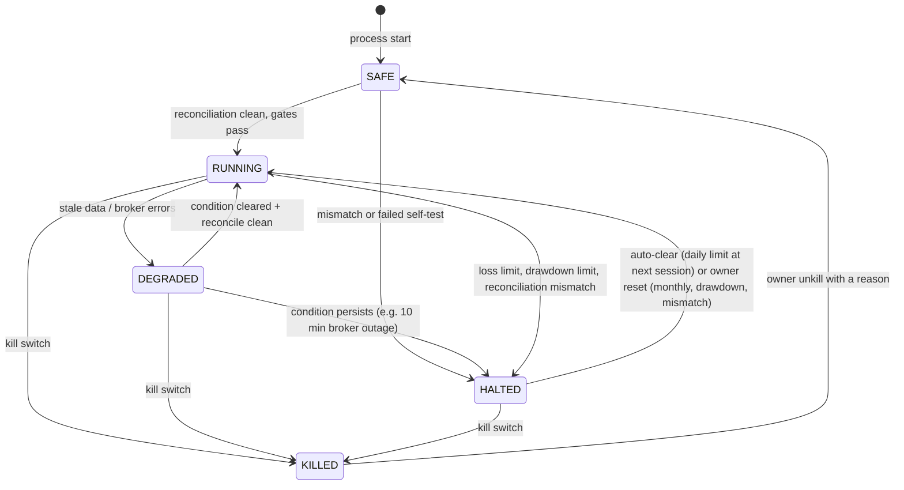

# 05. Risk Management Specification

The risk layer is plain, deterministic Python. It does not import the AI package (enforced in CI) and it keeps working when the AI service, the data vendor or the broker misbehaves. It has three lines of defence:

1. **Risk engine** (`aitrader.risk`): checks every order intent against the rules below and sizes it.
2. **Order gate** (`aitrader.execution.gate`): re-checks the hard caps immediately before every broker call.
3. **Independent watchdog** (separate program): watches heartbeats and state, alerts, and can set the kill flag.

Every rule has an ID. Every decision stores the result of every rule with the numbers used, so any rejection or approval can be explained later.

> **Honest limitation.** No rule can guarantee a maximum loss. Prices can gap through stop levels overnight or on news, stop orders can fill far below the stop price, and a broker or network outage can delay exits. The limits below stop **new** risk-taking; losses on positions already held can exceed them.

## 1. Initial parameters

PAPER uses the same values as the first LIVE stage, so paper evidence is representative.

| ID | Parameter | Initial value | Hard cap in code |
|---|---|---|---|
| R-TRADE-1 | Risk per trade, **including fees, FX cost and slippage allowance** | 0.5% of equity | 1.0% |
| R-DAY-1 | Daily loss limit (realised + unrealised vs. start-of-day equity) | 1.5% → no new entries until next session | 3.0% |
| R-MONTH-1 | Soft monthly loss level | 3% → risk per trade halved | — |
| R-MONTH-2 | Monthly loss limit (vs. month-start equity) | **5% → no new entries; resume only after owner re-enables (proposed, Q5)** | 5% |
| R-DD-1 | Drawdown from equity peak | 10% → HALTED, owner review | 15% |
| R-POS-1 | Maximum open positions | 4 | 8 |
| R-POS-2 | Maximum position size | 25% of equity per ETF; 10% per single stock | 30% |
| R-PORT-1 | Gross exposure | ≤ 100% of settled cash equity (**no leverage**) | 100% |
| R-PORT-2 | Minimum cash buffer | 5% of equity | — |
| R-PORT-3 | Portfolio ex-ante daily volatility (60-day estimate) | ≤ 1.2% of equity | 2.0% |
| R-ORD-1 | Orders per day (all types) | 8 | 20 |
| R-ORD-2 | Order size vs. 20-day average daily volume | ≤ 0.1% | 1% |
| R-LIVE-1 | Maximum order notional (LIVE_MICRO) | ¥30,000 equivalent | ¥50,000 |
| R-LIVE-2 | Maximum total holdings (LIVE_MICRO) | ¥100,000 equivalent | ¥100,000 |
| R-INST-1 | Instruments | Allow-listed symbols only; price ≥ USD 5; ETF average daily dollar volume ≥ USD 20M | allow-list mandatory |
| R-INST-2 | Prohibited | Short selling, margin, options, leveraged/inverse ETFs, OTC, extended-hours trading | always |
| R-EVT-1 | Earnings blackout (single stocks) | No new entry from 2 trading days before to 1 day after earnings | — |
| R-ECON-1 | Cost efficiency | Expected round-trip cost ≤ 20% of the trade's risk budget | — |
| R-ECON-2 | Minimum order | Quantity ≥ broker increment and value ≥ broker minimum; **never round up** | — |

Raising any value requires a config change (visible through the config hash). Raising a hard cap requires a code change, review and owner approval.

## 2. Position sizing (fees included)

Inputs: equity `E`, risk fraction `r` (R-TRADE-1), entry estimate `P_e` (limit price or last price + half spread), stop `P_s` from the strategy, broker cost model, FX cost model.

```
risk_budget       = E * r
loss_per_unit     = (P_e - P_s) + stop_slippage_allowance(P_e)     # default 0.5% of P_e; calibrated from gap statistics
round_trip_cost(q)= commission_buy(q, P_e) + commission_sell(q, P_s)
                  + regulatory_fees(q, P_s) + spread_and_slippage(q, P_e)
                  + fx_cost(q, P_e)                                # 0 if USD is already held
q_risk            = largest q with  q * loss_per_unit + round_trip_cost(q) <= risk_budget
q_caps            = min(q_risk, position cap, exposure cap, cash available, ADV cap)
q_final           = round_down(q_caps, broker_quantity_increment)
reject if q_final == 0 or q_final * P_e < broker_min_order_value       # R-ECON-2
reject if round_trip_cost(q_final) > 0.20 * risk_budget                # R-ECON-1
apply AI size multiplier m in [0, 1] (never above 1), then round down again
```

Worked example (¥50,000 ≈ USD 323 at ¥155/USD, stop 4% below entry, moomoo-style 0.132% commission): risk budget ≈ USD 1.61; maximum position ≈ USD 37; round-trip cost ≈ USD 0.13 (8% of budget) → approved. The same trade at a USD 1.00 minimum commission costs about 34% of the budget → rejected by R-ECON-1. Details in document 02, section 4.

## 3. Pre-trade check order

The engine evaluates every rule (no short-circuit) so the audit record is complete, then derives the verdict.

1. System state allows new entries (section 7) and the kill switch is not set.
2. Data quality gates for the symbol and the market (section 4).
3. Instrument rules (R-INST-*, R-EVT-1).
4. Circuit breakers (section 5).
5. Loss limits (R-DAY-1, R-MONTH-*, R-DD-1).
6. Duplicate and order-count rules (section 6, R-ORD-1).
7. Sizing (section 2) with portfolio caps (R-POS-*, R-PORT-*, R-LIVE-*).
8. Cost rules (R-ECON-*).

Exits (selling an existing long position, including stops) are always allowed unless the kill switch is in "freeze" mode; they are still checked for duplicates and quantity (never sell more than held).

## 4. Data quality gates

| ID | Check | Failure action |
|---|---|---|
| DQ-1 | Freshness: quote age ≤ 15 s at order time; previous session's daily bar present by 30 min after close | No new entries (symbol or all) |
| DQ-2 | Completeness: no missing bars in the look-back window (holidays from the exchange calendar) | No new entries for the symbol |
| DQ-3 | Sanity: price > 0, high ≥ max(open, close), low ≤ min(open, close), volume ≥ 0; ETF daily move > 25% needs second-source confirmation | Quarantine the bar; no new entries for the symbol |
| DQ-4 | Cross-source: when two sources exist, closes differ by < 0.5% | Flag; no new entries for the symbol |
| DQ-5 | Corporate actions: suspected split or large dividend without adjusted data | No new entries for the symbol until data is adjusted |
| DQ-6 | Clock drift vs. NTP ≤ 1 s | Refuse to trade |

## 5. Circuit breakers (price-based, independent of AI)

| ID | Trigger | Action |
|---|---|---|
| CB-1 | Symbol moved more than 3 × ATR(14) or more than 7% from the previous close | No new entries in that symbol today |
| CB-2 | Benchmark ETF (e.g. SPY) down ≥ 3% intraday | No new entries market-wide today |
| CB-3 | Exchange-wide circuit breaker or trading halt in a held symbol | No new orders; reconcile when trading resumes |
| CB-4 | Quoted spread wider than 30 bp (ETF) / 50 bp (stock) at order time | Delay; skip after the execution window |
| CB-5 | First-30-minute volume > 5 × its 20-day average (news-shock proxy) | No new entries in that symbol today |

These react to news shocks even when the AI service is down or late, because they use prices and volumes only.

## 6. Duplicate-order prevention

| ID | Rule |
|---|---|
| DUP-1 | `intent_id` is deterministic (strategy, version, symbol, side, signal timestamp, sequence). A unique index allows only one active order per intent. |
| DUP-2 | `client_order_id` is derived from `intent_id` and an attempt number. A new attempt is allowed only after the previous one is confirmed absent at the broker; at most one retry per intent. |
| DUP-3 | Before submitting, check open orders and positions: no second open entry order for the same symbol and side; caps are evaluated as if all open orders fill. |
| DUP-4 | At most 2 non-protective orders per symbol per day. |
| DUP-5 | Single instance: a file lock plus a database lease per mode and account. A second engine refuses to start. |

## 7. System states (halt state machine)



| State | New entries | Exits / protective stops | Cancels |
|---|---|---|---|
| SAFE | No | No (until reconciled) | Yes |
| RUNNING | Yes | Yes | Yes |
| DEGRADED | No | Yes | Yes |
| HALTED | No | Yes | Yes |
| KILLED | No | Protective stops kept; flatten only with explicit command | Yes (all entry orders cancelled) |

Halt states are stored in the database and **survive restarts**.

## 8. Connectivity and API failures

| ID | Condition | Action |
|---|---|---|
| CONN-1 | 3 consecutive broker errors, or ≥ 20% errors in 5 minutes | DEGRADED |
| CONN-2 | No successful broker call for 120 s in market hours | DEGRADED; after 10 minutes HALTED + critical alert |
| CONN-3 | Reconnect | Reconcile before leaving DEGRADED |
| CONN-4 | Market data stream down | Handled by DQ-1 |
| CONN-5 | LLM API down | Strategy runs without AI overlay (see document 11); warning alert if repeated |

## 9. Stop orders and their limits

| ID | Rule |
|---|---|
| STOP-1 | Every entry intent must carry a stop price. Sizing uses it. |
| STOP-2 | After an entry fills, place a protective stop **at the broker** (GTC) if the broker supports it for that position type. Otherwise the engine runs a **system-side stop** checked every minute in regular hours, which sends a marketable limit order. |
| STOP-3 | Stops are only ever tightened (e.g. trailing rules), never widened automatically. |
| STOP-4 | If placing a broker-side stop fails twice: switch to the system-side stop, block new entries, alert. |
| STOP-5 | Known limits, documented in reports: overnight gaps fill below the stop; stop-limit orders may not fill; fractional positions often cannot carry stop orders; system-side stops need the engine to be alive (hence the watchdog). Backtests model gap fills at the open. |

## 10. Crash recovery

1. systemd restarts the process (rate-limited restarts).
2. The process starts in **SAFE**: database integrity check, single-instance lock, load state.
3. Query the broker: account, positions, open orders, fills since the last checkpoint.
4. Resolve every order in `PENDING_SUBMIT` or `UNKNOWN` by `client_order_id`. Apply missing fills.
5. Compare positions (exact for whole shares; 1e-6 for fractional) and cash (tolerance USD 0.05 or 0.1%).
6. Mismatch → HALTED, critical alert, **no automatic correction**. Match → restore the persisted state (a halt before the crash stays a halt).
7. Missed schedule windows are skipped, not chased (no late entry orders after the execution window).

Reconciliation also runs after every reconnect, every 15 minutes in market hours (orders and positions) and in full at the end of the day.

## 11. Kill switch

- Triggers: CLI `aitrader kill`, a kill flag in the database, a remote flag in object storage polled every 30 s (lets the owner or the watchdog stop the engine from outside), or automatically on critical incidents.
- Effects: block new orders; cancel all open non-protective orders; keep protective stops by default; `aitrader kill --flatten --confirm` also closes positions with marketable limit orders.
- Clearing requires `aitrader unkill --reason "..."` by the owner. Every kill and unkill is an audit event.
- Fallback runbook: if the engine host is unreachable, the owner cancels orders in the broker's own app (documented per broker).

## 12. Independent watchdog

| ID | Rule |
|---|---|
| WD-1 | Engine sends a heartbeat every 60 s: state, last data timestamp, last reconciliation, open orders, day P&L. |
| WD-2 | Alert if no heartbeat for 3 minutes in market hours (15 minutes outside). |
| WD-3 | Alert on HALTED or KILLED, stale data, or no reconciliation for 30 minutes in market hours. |
| WD-4 | The watchdog can set the remote kill flag. It holds no broker credentials (credentials stay on one host). |
| WD-5 | The watchdog is itself watched: it runs on a different platform (heartbeat SaaS or a cloud function) and sends a daily "alive" summary; missing summary = problem. |
| WD-6 | Alerts go to at least two independent channels (email + push). Muse is never the only channel. |

## 13. Hard caps enforced by the order gate

| ID | Hard cap |
|---|---|
| HC-1 | No short selling: a SELL can never exceed the held quantity. |
| HC-2 | No leverage: buying power used ≤ settled cash; gross exposure ≤ 100% of equity. |
| HC-3 | Only stocks/ETFs on the allow-list; no options, futures, crypto, leveraged or inverse ETFs. |
| HC-4 | LIVE order notional ≤ ¥50,000 equivalent. |
| HC-5 | LIVE total holdings ≤ ¥100,000 equivalent. |
| HC-6 | ≤ 20 orders per day. |
| HC-7 | Regular trading hours only. |
| HC-8 | Every order references an approved `RiskDecision` for the same intent and quantity. |
| HC-9 | Kill switch not set; system state allows the order type. |

## 14. How AI interacts with risk

- AI can return, per symbol or market-wide, a **veto** (skip new entries) and a **size multiplier m ∈ [0, 1]**.
- The final quantity is the risk-approved quantity × m, rounded down. AI can never raise a quantity, add an order, move a stop or change a limit.
- Invalid, late or missing AI output means "no AI overlay", i.e. the rule-based baseline (document 11).

## 15. Test requirements

- Every rule ID has unit tests at, just below and just above its threshold.
- Property tests (hypothesis): no approved order ever breaks a hard cap; fees are always inside the risk budget; ledger always balances; a SELL never exceeds holdings.
- Fault-injection tests: crash between write-ahead record and broker call; broker timeout after accepting an order; duplicate fill events; stale quotes; malformed broker responses; clock jumps; database locked; kill switch during an open order.
- These tests are part of LiveGuard gate G5.
