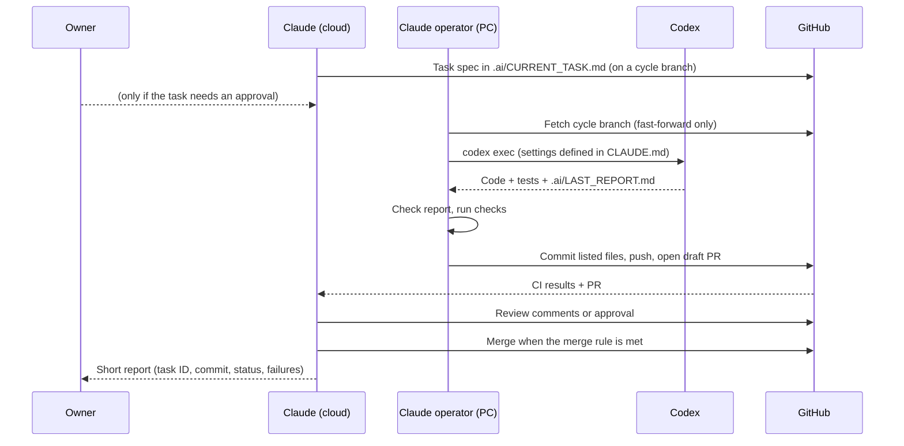

# 06. Roles: Claude, Codex, Muse and the Owner

## 1. Who does what

| Role | Actor | Responsibilities | Not allowed |
|---|---|---|---|
| Owner | You | Approve design, phases, sign-ups, spending, LIVE activation and limit changes; receive critical alerts; handle broker accounts and real credentials. | — |
| Architect / reviewer | Claude (cloud session) | Architecture, strategy research and design, task specifications for Codex, code review, analysis of backtest and paper results, improvement proposals, merging under the merge rule below. | Writing product or test code; handling real credentials; enabling LIVE; changing risk limits without owner approval. |
| Operator | Claude on the owner's PC | Runs Codex, does all Git work (branch, commit, push, draft PR), checks Codex reports, cleans up work files, reports cycle start/finish. | Editing `~/.codex/config.toml`; bypass or full-access flags; force-push or history rewrites; paid services; anything outside the project folder. |
| Implementer | Codex | Python implementation, API adapters, backtest engine, trading engine, automated and fault tests, bug fixes, performance work, change proposals as PRs. | Touching live configuration or secrets; disabling tests; weakening hard caps or LiveGuard; adding dependencies outside the task scope without saying so. |
| Operations assistant (future) | Muse (Meta AI) | Read reports and status; summarise health; analyse anomaly logs; help investigate incidents; draft daily/monthly P&L commentary; report issues. | Any write access: no orders, no config, no code, no credentials. Its output is advisory and goes through Claude review before any change. |

## 2. Development cycle (one task)

## 3. Proposed merge rule

Claude may merge a pull request only when **all** hold:

1. CI is green on the latest commit (lint, type check, tests, import rules).
2. The task's acceptance criteria in `.ai/CURRENT_TASK.md` are met and evidenced in `.ai/LAST_REPORT.md`.
3. Claude's review has no open blocking findings.
4. The PR does **not** touch any owner-protected area:
   - `src/aitrader/risk/` limits or hard caps, `src/aitrader/execution/gate*`, LiveGuard, `config/live*`;
   - anything that enables LIVE or adds a live broker credential path;
   - new paid services or new external sign-ups.

PRs that touch a protected area need the owner's explicit approval in the PR before merging.

## 4. Files that will be created after design approval

These files configure the automated loop. They are **not** created yet, so the loop cannot start before you approve the design.

| File | Purpose |
|---|---|
| `CLAUDE.md` | Rules for Claude: design/review role, merge rule, protected paths, how the operator starts Codex (approval mode, sandbox), report format. |
| `AGENTS.md` | Rules for Codex: coding standards, test requirements, forbidden actions, how to write `.ai/LAST_REPORT.md`, stop-and-report conditions (BLOCKED). |
| `.ai/CURRENT_TASK.md` | The single active task specification (first one: document 10). |
| `.ai/LAST_REPORT.md` | Codex's report: changed files, commands run, test results, open issues. |

## 5. Guardrails for AI coding agents

- Secrets never enter the repository. A secret-scanning check runs in CI.
- Codex works only inside the repository folder and the cycle branch.
- Tests may not be skipped, disabled or weakened to make CI pass; Claude's review checks for this.
- Changing a risk threshold is a configuration change with its own PR and owner approval, never a side effect of another task.
- Dependencies are added only with a reason in the report and pinned in the lock file.

## 6. Muse: integration plan and what still needs checking

### 6.1 What is known (2026-10-23)

| Fact | Status |
|---|---|
| "Muse Spark" is Meta's model family (from Meta Superintelligence Labs), launched in April 2026, powering the Meta AI assistant. | [S] |
| Meta Model API offers Muse Spark in **public preview to developers in the US**, self-serve, with OpenAI-compatible and Anthropic-compatible request formats, tool calling and built-in web search; launch pricing USD 1.25 / 4.25 per million input/output tokens (Muse Spark 1.1). | [V] Meta developer blog, 2026-07-08 |
| Newer versions (1.2, 1.3) exist. | [S] |
| Availability of the developer API to Japan-resident developers. | **[U]** |
| Full availability of the Meta AI consumer app in Japan. | **[U]** (a Japanese tech site said the timing is not announced [S]) |
| Data retention / training use for API inputs, and terms for financial data. | **[U]** |

Sources: https://dev.meta.ai/resources/blog/build-with-muse-spark/ , https://ai.meta.com/blog/introducing-muse-spark-meta-model-api/ , https://www.implicator.ai/meta-delays-muse-spark-developer-api-again-with-no-launch-date-set/ (secondary).

### 6.2 Integration design (works whatever Muse turns out to support)

The system publishes a **read-only operations bundle** (document 13): status JSON, daily and monthly reports (JSON + Markdown), incident list and recent anomaly log excerpts. Secrets and full account numbers are never included.

Three possible integration levels, from simplest to most automated:

| Level | How | Needs |
|---|---|---|
| M1 Manual | Owner opens the Meta AI app and shares the daily report text. | Meta AI available to the owner in Japan |
| M2 Push | A small `muse_adapter` sends the bundle with a fixed prompt to the Meta Model API and stores Muse's answer as an advisory note in the database and in the next report. | API access from Japan; acceptable data terms |
| M3 Pull | Muse calls a read-only, token-protected status API through tool calling. | M2 + a safely exposed read-only endpoint |

In all levels Muse has **no write path**. If Muse is unavailable, the same analysis job runs on Claude, and the independent watchdog keeps sending critical alerts.

### 6.3 Verification steps (Phase 5, before adopting Muse)

1. Confirm that a Japan-resident developer can create a Meta Model API account (or that the Meta AI app is available).
2. Read the API terms: data retention, training use, restrictions on financial content.
3. Test with synthetic (fake) reports first: quality of Japanese summaries, correctness on known anomalies, hallucination rate, latency, cost.
4. Decide the level (M1, M2 or M3) with the owner. No real account data is sent before the owner approves.
