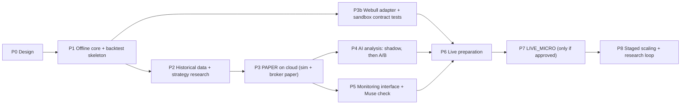

# 07. Development Roadmap

Each phase ends with an exit review by Claude and a go/no-go by the owner. Durations are rough estimates [A]; they depend on Codex cycle speed and on how much paper time the evidence needs. Paper-trading durations are minimums, not targets.

## Overview

| Phase | Goal | Main deliverables | Owner approvals needed | Exit criteria | Estimate |
|---|---|---|---|---|---|
| **P0** Design | Agree on the design | This package | Q1 | Owner approves (with changes if any) | now |
| **P1** Offline core | Working skeleton with no external services | Project setup, domain model, config with hard caps, risk engine, ledger, order manager, `SimBroker`, backtest loop on fixture data, metrics, CLI, CI | none | CI green; fixture backtest reproducible (same inputs → same outputs, same manifest hash); every risk rule tested; import rules enforced | 2–4 weeks |
| **P2** Data + research | Real historical data and baseline strategies | Data ingestion + quality gate + Parquet store; S1/S2 baseline strategies with the `webull_jp` cost profile; walk-forward runner; locked hold-out; research report | Owner signs up for the Alpaca paper-only account, used for data only (Q2 decided) | Report with all metrics in document 12, including costs and benchmark; hold-out not touched; documented go/no-go per strategy | 2–4 weeks |
| **P3** PAPER | Unattended operation of the virtual portfolio with live data | Scheduler, live data adapter, PAPER virtual portfolio (`SimBroker` + ledger), reconciliation of the virtual book, kill switch, heartbeat + watchdog, notifications, daily report, operating-cost ledger, cloud deployment | Creating the Google Cloud project `aitrader-paper` (asked at P3 start; Q3 and Q4 decided) | ≥ 20 consecutive trading days without unhandled incidents; ledger checks clean every day; fault drills (kill process, cut network, stale data, kill switch) passed | 4–8 weeks |
| **P3b** Webull adapter | Prove the Webull connection before any account exists | `aitrader.broker.webull` on the pinned official SDK; broker-agnostic contract tests; sandbox runs SB-1 to SB-6 (document 14); known error-code table | None beyond design approval (Q10 decided) | Contract tests green against `SimBroker` and the Webull Sandbox; findings recorded in document 14 | 2–3 weeks, in parallel with P3 |
| **P4** AI | Measure whether AI adds value | News/filings/macro ingestion; input-bundle export; private data repository; Claude Code scheduled task (Opus 5.5) with versioned prompt and schema; advisory import and validation; replay store; **shadow mode** (recorded, not used) ≥ 4 weeks; then two parallel paper books: baseline vs. AI overlay | Creating the data repository and the scheduled task (asked at P4 start); Q6 decided | A/B report with statistical test (document 12); missed-run rate; decision to keep, change or drop the overlay | 3–6 months (runs in parallel with P5/P6) |
| **P5** Monitoring | External read-only access | Status bundle, read-only status API (private), report templates, Muse verification (document 06) | Muse data-sharing decision | Owner can see health and P&L without logging into the server; Muse decision recorded | 2–3 weeks |
| **P6** Live prep | Decide whether live trading is technically and economically possible | Owner opens the Webull account and applies for OpenAPI; answers to WB-1 to WB-8 (document 14); OpenAPI market data subscription (Nasdaq Basic); fault tests on the adapter; economic feasibility review; checklist (document 09) | Owner opens the Webull account and applies for OpenAPI (Q7–Q9 decided: Phase 6, 2FA on, tokutei with withholding) | Checklist complete. **If the economic or technical gates fail, the project stays in PAPER** | 2–4 weeks |
| **P7** LIVE_MICRO | Validate real execution at minimum size | LIVE host and secrets (production keys generated by the owner), IP allow-list, LiveGuard approval file, live limits (¥50,000 capital), go-live runbook | Explicit written LIVE approval | ≥ 2–3 months with no unexplained reconciliation differences; slippage and costs within expectations; no limit breaches | 2–3 months minimum |
| **P8** Scaling + research | Improve safely | Limit increases in steps (each approved); research sandbox; strategy promotion process (document 11) | Each limit increase | Ongoing | ongoing |

Earliest realistic LIVE_MICRO start: roughly 5–8 months after P1 starts [A], because AI evaluation and paper stability need calendar time. Starting LIVE earlier without AI is possible (rule-based only) if the owner prefers; the AI A/B can then continue in paper.

## Codex task backlog (P1 and early P2)

| Task | Title | Depends on |
|---|---|---|
| TASK-001 | Project skeleton, domain model, configuration with hard caps, CI | — |
| TASK-002 | Risk engine (all R-*, DQ-*, CB-* rules that work on fixture data) with unit and property tests | 001 |
| TASK-003 | Ledger (cash by currency, settled cash, fees, operating costs) with property tests | 001 |
| TASK-004 | Order manager state machine, order gate, `SimBroker`, fault tests | 002, 003 |
| TASK-005 | Backtest event loop, fill and cost models, metrics, run manifest, CLI `backtest` | 004 |
| TASK-006 | Market data ingestion (Alpaca, read-only, decision Q2), quality gate, Parquet store | 005, owner sign-up |
| TASK-007 | Baseline strategy S1 + walk-forward runner + research report (S2 was implemented in TASK-005) | 006 |
| TASK-008 | Webull adapter on the official SDK + broker contract tests (sandbox runs allowed once the design is approved, decision Q10) | 004 |
| TASK-009 | SQLite storage: order store, durable journal and halt state, decision log, runs, single-instance lock and lease | 004 |
| TASK-010 | Reconciliation of the engine's books against the broker (positions, cash, open orders); mismatch → HALTED | 009 |

TASK-001 is specified in detail in document 10. Later tasks are specified one at a time after the previous one is merged.
