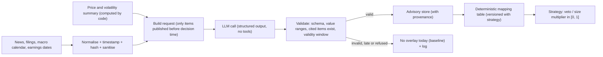

# 11. Strategy Research and AI Analysis Design

## 1. Approach

1. Start with **rule-based** strategies that are simple, well known, have few parameters and trade rarely. They are the baseline.
2. Add AI only as an **overlay** that can reduce or veto risk, and measure it against the baseline (section 7).
3. Never let the running system change its own rules. Improvements go through research, review and approval (section 9).
4. The 1–2% monthly target is a research target, not an assumption. A strategy is judged on risk, stability, reproducibility and cost as much as on return.

## 2. Universe (U0)

Liquid US-listed ETFs only for the first live stage. The list is fixed **before** any backtest to avoid choosing winners after the fact, then filtered by liquidity and by price relative to the maximum position size.

| Group | Examples |
|---|---|
| US broad market | S&P 500 trackers (several share-price levels), total-market ETFs |
| Growth / size | Nasdaq-100 trackers, small-cap index ETFs |
| US sectors | The eleven Select Sector SPDR ETFs |
| Defensive / cash proxy | Short-term Treasury ETFs, intermediate and long Treasury ETFs |
| Real assets | Gold ETFs |

Excluded: leveraged and inverse ETFs, ETNs, single stocks (until a later phase with point-in-time data and earnings handling), anything below USD 5 or with low dollar volume.

## 3. Baseline strategies

Parameters are fixed sets, not optimised per instrument. Walk-forward testing (document 12) selects at most among a small, pre-declared grid.

### S1 — Trend-filtered momentum rotation (weekly)

| Element | Rule |
|---|---|
| Signal time | Friday close (or last session of the week) |
| Ranking | 126-day total return (optionally skipping the last 5 days) |
| Filter | Only ETFs closing above their 200-day simple moving average |
| Holdings | Top 2–3 qualifying ETFs, equal risk; if none qualify, hold the cash proxy or cash |
| Stop | 3 × ATR(20) below entry (typically 3–5% for broad ETFs), tightened only |
| Exit | Drops out of the top ranks at a weekly review, closes below the 200-day average, or stop hit |
| Expected trades | A few per month |

### S2 — Pullback in an uptrend (daily)

| Element | Rule |
|---|---|
| Instruments | Broad-market ETFs only |
| Entry | Close above the 200-day average **and** RSI(2) below 10 (short-term pullback) |
| Exit | Close above the 5-day average, or after 5 sessions |
| Stop | 2.5 × ATR(20) below entry |
| Note | Popular rule with documented decay over time and high cost sensitivity; kept as a test of whether a short-term edge survives our cost model. |

### Benchmarks

- **B0:** buy-and-hold of an S&P 500 ETF with the same capital and the same cost model.
- **B1:** cash (zero return), to show whether trading beats doing nothing after costs.

## 4. Execution rules

- Decisions use completed daily bars only. Orders are sent in the next session's execution window (09:35–10:30 ET).
- Entries: limit orders at the current quote plus a small collar (for example the mid-price plus max(one tick, 5 bp)), capped at 1% above the previous close. Not filled by the end of the window → cancelled, no chasing.
- Exits: marketable limit orders; if not filled, retried with a wider collar; exits take priority over entries.
- Protective stops: see document 05, section 9.
- Alternative to be tested in research: execution near the close (15:45–15:55 ET) on same-day signals. The default stays next-session execution because it is simpler to reproduce in backtests.

## 5. AI analysis pipeline

### 5.1 Tasks given to the AI

| Task | Output (strict JSON schema) | Used for |
|---|---|---|
| T1 Market regime | `regime` ∈ {risk_on, neutral, risk_off, uncertain}, `confidence` 0–1, `key_drivers[]`, `event_risk_next_48h[]`, `rationale` (short), `cited_item_ids[]` | Market-wide size multiplier |
| T2 Symbol event risk | per symbol: `flag` ∈ {none, elevated, severe}, `horizon_days`, `reason`, `cited_item_ids[]` | Symbol veto |
| T3 Daily narrative | Short summary of what happened and why positions changed | Reports only, no trading effect |

The AI never receives account balances, credentials or order details; it does not need them.

### 5.2 Mapping AI output to actions (code, not AI)

| AI output | Action |
|---|---|
| T1 `risk_off`, confidence ≥ 0.7 | New entries × 0.5 |
| T1 `uncertain`, or confidence < 0.5 | No change |
| T2 `severe` | Veto new entries in that symbol for `horizon_days` (max 5) |
| T2 `elevated` | New entries in that symbol × 0.5 |
| Anything invalid, missing, late, refused or over budget | No overlay (baseline) |

The mapping is part of the versioned strategy configuration, so its effect is reproducible and reviewable. AI output can never increase size, add orders or change stops.

### 5.3 Model and call settings

- Default model `claude-opus-5-5` (configurable). Structured outputs through `output_config.format`; adaptive thinking with an explicit effort level; refusal (`stop_reason: "refusal"`) is treated as "no overlay".
- Non-urgent jobs use the Message Batches API (50% cheaper). The pre-market job has a hard deadline (09:00 ET); missing it means no overlay that day.
- The current API no longer accepts sampling parameters such as temperature, so outputs are not exactly repeatable. **Every request and response is stored** (prompt template version, input item hashes, model ID, token usage, cost) and backtests replay the stored outputs instead of calling the model again.
- A monthly budget cap is enforced before each call (document 08).

### 5.4 Safety of AI inputs

- News text is untrusted. It is stripped of markup, length-limited and placed in a clearly marked data section; the instructions state that content inside it is data, not instructions.
- The AI call has no tools and no network access. Output must match the schema; `cited_item_ids` must refer to items that were actually in the request (simple hallucination check).

## 6. Handling shocks, delays, uncertainty and regime change

| Situation | Measures |
|---|---|
| Sudden price move on news | Price/volume circuit breakers CB-1, CB-2, CB-5 work without AI (document 05); AI T2 flags add a veto; earnings blackout for single stocks; protective stops |
| Information delay | Every item carries `published_at` and `retrieved_at`; the pipeline measures latency; only items published before the decision time are used; AI signals have `valid_until` (next session close) and are ignored when stale |
| AI cannot decide | `uncertain` → no change; invalid or missing → baseline; repeated failures → warning alert |
| Market regime change | Rule-based regime filter inside the strategies (200-day average, realised volatility); live performance monitor compares rolling 60-day results with the backtest distribution — outside the expected band (e.g. drawdown > 1.5 × the backtest's typical drawdown at that horizon) → sizes halved automatically and a review alert. Rules themselves are not changed automatically. |

## 7. Measuring AI value (AI on vs. AI off)

**Look-ahead problem specific to LLMs:** a language model trained on data up to its training cutoff "knows" what happened after many historical dates. Backtesting an AI overlay on history before the cutoff therefore leaks future information and overstates its value. For this reason:

- AI value is measured **forward**: shadow mode first (AI output recorded but not used), then two **parallel paper books** with the same capital, rules and fill model:
  - Book A: baseline rules only.
  - Book B: baseline + AI overlay.
- Historical tests with AI are only run on data after the model's training cutoff, and labelled as such.

Evaluation:

| Measure | Purpose |
|---|---|
| Daily return difference B − A, net of AI cost | Main effect |
| Max drawdown, volatility, Sharpe of each book | Risk effect |
| Vetoed / reduced trades and their counterfactual outcome | Did the vetoes avoid losses or cost gains? |
| AI cost per month and per changed decision | Economics |

Statistics: paired block bootstrap of daily return differences, reported with confidence intervals. With a few trades per month, **3–6 months may still be inconclusive**; the pre-registered rule is: keep the overlay in LIVE only if the net-of-cost improvement (return or drawdown) is supported by the confidence interval; otherwise run LIVE without AI and keep researching in paper. The owner makes the final call.

## 8. Strategy versioning

- Each strategy has an ID and a semantic version. Parameters live in a versioned file whose hash is stored with every intent.
- A change in rules, parameters or the AI mapping table is a new version, with its own backtest and paper record.

## 9. No self-modification in production

- The production process has **read-only** access to code, strategy files and limits (file permissions on the host).
- No component, including the AI service, can write parameters or rules at runtime.
- Improvement ideas (from Claude, Muse or the owner) go to a **research environment** (separate branch, database and data snapshot): walk-forward test → untouched hold-out → shadow paper → review → owner approval for anything that affects risk → release with a new version.
- Any learned model (if ever used) is trained offline, frozen as a file with a hash and promoted through the same process.
