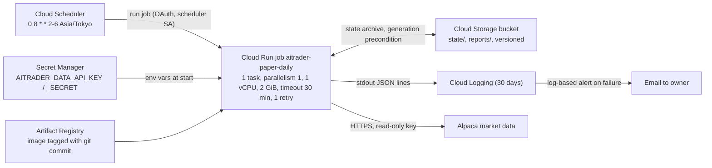

# 15. PAPER daily run on Google Cloud at zero cost

- **Status:** Approved by the owner on 2026-10-26 (option A, including the secrets rule change in
  section 6). Nothing has been created in Google Cloud yet. The owner creates the billing account,
  the project and the secret values (section 8, step 1); creating resources in the project
  (step 3) and the cut-over (step 5) are asked for at that time.
- **Owner direction (2026-10-26):** move the daily automated PAPER run to Google Cloud soon,
  free of charge, while strategies are improved; no real money until a strategy passes.
- **Prices:** checked on the official pages listed in section 10 on 2026-10-26. Tags follow the
  legend in `README.md` ([V] verified, [U] unverified, [A] assumption).

## 1. What has to run

Today Windows Task Scheduler "AI-Trader PAPER daily" on the operator PC runs, Tuesday to Saturday
at 08:00 JST:

1. `aitrader data fetch --end <latest closed session>` (needs the read-only Alpaca data key);
2. `aitrader paper run` (S1 reference book, `data/paper`);
3. `aitrader paper run --config config/paper-s3.yaml --state-dir data/paper-s3` (S3 observation
   book).

The PAPER commands are offline replays (document 04 §11): every run rebuilds both books from
`paper.start` and checks that recorded sessions are reproduced exactly. A run is a short batch job
with files in and files out. Nothing has to stay running between days, and missed days catch up on
the next run. This shapes the choice below.

## 2. Options compared

| | A. Cloud Run job + Cloud Scheduler (recommended) | B. Always Free e2-micro VM + cron/systemd timer |
|---|---|---|
| Compute | Job billed only while it runs. Free tier for jobs: 240,000 vCPU-seconds and 450,000 GiB-seconds per month, per billing account [V] | One e2-micro (2 shared vCPU, 1 GB RAM) free per month in `us-east1`, `us-central1` or `us-west1` [V] |
| Internet access to Alpaca | Built in: outbound internet access by default, no public IP or NAT to pay for | Needs an external IPv4 address or Cloud NAT. In-use external IPv4 on a standard VM: USD 0.005/hour = **USD 3.65/month** [V]. The official pages do not state that the free-tier VM is exempt [U]. Cloud NAT also charges its IP at USD 0.005/hour plus gateway fees [V] |
| Disk | None; state lives in Cloud Storage (section 4) | 30 GB-month **standard** persistent disk free [V]. The console's default boot disk type is balanced, which is not in the free tier: a common surprise charge |
| Scheduler | Cloud Scheduler: 3 jobs free per billing account, then USD 0.10/job/month [V] | cron or a systemd timer on the VM (free) |
| Operations | No OS to patch; each run starts from a fresh, pinned image | OS updates, disk full, SSH access, time sync, reboot handling are ours |
| Spend cap support | Cloud Run is one of four services covered by Cloud Billing spend caps [V] | Compute Engine is not covered [V] |
| Fit for later P3 work | Fine for daily bars. An always-on process (live quotes, kill switch, heartbeat) needs a re-decision | Fits an always-on process; LIVE will need a VM with a static IP anyway (D-08) |

**Recommendation: option A.** It is the only option whose expected cost is USD 0 without relying on
an unstated exemption, it needs no server administration, and Cloud Run supports a spend cap.
Option B is cheaper to adapt later for an always-on process, but that need is several tasks away
and would be reassessed then. This is a deliberate deviation from D-08 ("Compute Engine, managed
by systemd") for PAPER stage 1 only; D-08 stays the target for LIVE.

Rejected: GitHub Actions on a schedule. It is not Google Cloud, and `CLAUDE.md` forbids the data
key in CI.

## 3. Architecture (option A)

All resources in one project, `aitrader-paper`, region `us-east1` (free-tier region for Cloud
Storage and Compute; Tier 1 pricing for Cloud Run [V]).

- **Schedule:** `0 8 * * 2-6` in time zone `Asia/Tokyo` = 23:00 UTC Monday to Friday. The US
  close is 20:00 UTC (EDT) or 21:00 UTC (EST), so the free plan's 15-minute delay on recent SIP
  data is cleared by two hours or more. Market holidays need no special handling: the run records
  no new session and exits 0.
- **One writer:** the job runs one task with parallelism 1; Cloud Scheduler has no overlap
  because a run takes minutes. The state upload uses an object-generation precondition (section 4),
  so a second writer (for example a manual run at the same time) fails instead of overwriting.
- **Identity:** two service accounts. The runtime account may only read the two secrets and
  read/write objects in the one bucket. The scheduler account may only run that one job. No keys
  are exported for either account.
- **Image:** built from a tagged commit on `main` with green CI, by the operator with
  `gcloud builds submit` (Cloud Build: 2,500 build-minutes/month free [V]) or `gcloud run jobs
  deploy --source`. The image passes its commit to `--git-commit`. Artifact Registry cleanup
  policy keeps the newest 2 images so storage stays under the 0.5 GB free tier [V]. The previous
  image is the one-command rollback.

## 4. State, data and reports

The job is stateless; Cloud Storage holds everything that must survive between runs.

| Object | Content | Size [A] |
|---|---|---|
| `state/paper-state.tar.gz` | `data/bars/` (raw and adjusted series, fetch report), `data/paper/`, `data/paper-s3/` | ≈ 10–30 MB |
| `reports/latest/` | Copies of both `status/latest.json` files and the newest daily reports, for reading in the console or on a phone | < 1 MB |
| `reports/daily/` | Daily reports, never rewritten | < 1 MB/month |

Run sequence: download the archive and remember its generation → unpack into a temporary
directory → fetch → run both books → pack → upload with `ifGenerationMatch=<remembered
generation>` → copy reports. Any failure before the upload leaves the previous state untouched.
SQLite is never opened on a network file system (Cloud Storage FUSE gives no file locking), only on
the container's local disk.

Backups: object versioning on, lifecycle rule keeps the 30 newest non-current versions of the
archive (≈ 30 × 30 MB = 0.9 GB worst case, under the 5 GB free tier [V]). Soft-deleted and
non-current objects are billed like live ones [V], so they are included in that estimate.

Market data stays private: the bucket has uniform bucket-level access, public access prevention
on, and no `allUsers` bindings. This keeps the `CLAUDE.md` rule that real data is never committed;
the rule that real data lives only under `data/` is extended to this private bucket (section 6).

Start of the cloud books: instead of copying the Windows state, the cloud starts with an empty
state and replays from `paper.start` (2026-10-26). Replay makes the result identical by
construction, and this avoids carrying over the Windows CRLF snapshot-hash difference seen on
the operator PC.

## 5. Logs and alerts

- The job writes JSON Lines to stdout (document 13 §2); Cloud Logging keeps them 30 days at no
  cost within 50 GiB per project per month [V]. Expected volume is far below 1 MB/day.
- One log-based alert policy: "job execution failed or exit code ≠ 0" → email to the owner.
  Alerting is not charged before 2027-09-01 at the earliest; log-match conditions return no points
  [V]. Re-check the price before 2027-09-01.
- Exit code 6 (replay mismatch) is a separate alert text that says "stop, do not delete state,
  report to the designer" (document `docs/dev/setup.md`).
- Missing run: a second alert when no successful execution was logged by 10:00 JST on a
  scheduled day (log-absence condition). If that condition turns out to be charged or unavailable,
  the daily report check stays manual.

## 6. Secrets

- Only the Alpaca read-only data key is needed. Two secrets, `aitrader-data-api-key` and
  `aitrader-data-api-secret`, one version each, automatic replication. They are exposed to the job
  as the environment variables the code already reads (`AITRADER_DATA_API_KEY`,
  `AITRADER_DATA_API_SECRET`), so no code reads Secret Manager directly.
- The owner creates the secret versions in the Cloud console by pasting the values. The values
  never pass through Claude, Codex, a chat, the repository or CI. Free tier: 6 active versions and
  10,000 accesses per month [V]; we use 2 versions and ≈ 50 accesses.
- Webull keys of any kind are not placed in this project. PAPER uses SimBroker.
- **Rule change (approved by the owner 2026-10-26):** the data key lives on the operator PC and in
  Secret Manager of project `aitrader-paper`. `CLAUDE.md` is updated accordingly.

## 7. Guards against charges

Facts that drive the guards [V]: a billing account is required even for the free tier; the free
tier has no end date but Google may change it; free usage does not roll over; budgets alone do not
stop spending and cost data arrives with a delay; spend caps are not instantaneous and overage
during the delay is still billed.

| Guard | Setting |
|---|---|
| No Free Trial credit dependency | The design is sized for Free Tier limits, not the USD 300 trial credit, so nothing changes when the trial ends |
| Budget on the billing account | JPY 100/month, email at 50%, 90%, 100% of actual cost and 100% of forecast |
| Spend cap on project `aitrader-paper` | Cloud Run capped at a small amount (for example JPY 100); new executions are blocked when it is reached |
| Only free-tier resource types | No VM, no external IP, no NAT, no load balancer; bucket in `us-east1` Standard class; Artifact Registry in `us-east1` |
| Hard job limits | 1 task, parallelism 1, timeout 30 min, max 1 retry, 1 vCPU, 2 GiB |
| Optional: disable billing automatically | Budget → Pub/Sub → Cloud Run function that unlinks billing from the project when the budget is exceeded (Google's documented pattern). It stops everything in the project, which is acceptable for PAPER. Adds a function and a billing permission, so only on the owner's request |

### Usage against the free tier (per month, 22 trading days)

| Resource | Expected use [A] | Worst case allowed by the limits | Free tier [V] | Worst case as % of free tier |
|---|---|---|---|---|
| Cloud Run job CPU | 22 runs × 10 min × 1 vCPU = 13,200 vCPU-s | 22 × 2 attempts × 30 min = 79,200 vCPU-s | 240,000 vCPU-s | 33% |
| Cloud Run job memory | 26,400 GiB-s | 158,400 GiB-s | 450,000 GiB-s | 35% |
| Cloud Scheduler | 1 job | 1 job | 3 jobs | 33% |
| Secret Manager | 2 versions, ≈ 50 accesses | 2 versions, 88 accesses | 6 versions, 10,000 accesses | 33% / 1% |
| Cloud Storage | ≈ 0.3 GB, ≈ 200 class A ops | 0.9 GB, ≈ 1,000 class A ops | 5 GB, 5,000 class A | 18% / 20% |
| Artifact Registry | 2 images ≈ 0.3 GB | 0.5 GB | 0.5 GB | up to 100%: the tightest limit |
| Cloud Build | ≈ 10 build-min (a few deploys) | ≈ 50 build-min | 2,500 build-min | 2% |
| Cloud Logging | < 30 MB | < 1 GB | 50 GiB | 2% |
| Egress | requests only, < 50 MB | < 0.5 GB | 1 GB (Cloud Run) | 50% |

The run time of 10 minutes is an assumption; replay was measured at a few seconds per book on the
Mac (document 04 §11) and the fetch time on Windows has not been measured [U]. The first cloud run
measures it.

### Cost if the free tier disappeared or a limit was misjudged

| Item | Price beyond free tier [V] | Monthly cost at the worst case above |
|---|---|---|
| Cloud Run job | USD 0.000018/vCPU-s, USD 0.000002/GiB-s | 79,200 × 0.000018 + 158,400 × 0.000002 = USD 1.74 |
| Cloud Scheduler | USD 0.10/job | USD 0.10 |
| Secret Manager | ≈ USD 0.06/version, USD 0.03/10,000 accesses | USD 0.15 |
| Cloud Storage | ≈ USD 0.02/GiB-month (us-east1), USD 0.005/1,000 class A | USD 0.02 |
| Artifact Registry | ≈ USD 0.10/GiB-month | USD 0.05 |
| **Total** | | **≈ USD 2.1/month (≈ JPY 320 at JPY 155/USD [A])** even with no free tier at all |

At expected use without any free tier the total is ≈ USD 0.6/month. For comparison, option B's
external IPv4 alone is USD 3.65/month if the free VM is not exempt [U]. The realistic risk is not
these numbers but a mistake such as an extra VM, a balanced disk or a runaway loop; the budget
alert, the spend cap and the resource-type rule above address those.

## 8. Migration plan

| Step | Who | What | Exit criterion |
|---|---|---|---|
| 0 | Owner | Approve this design and the secrets rule change (section 6) | Approval in the PR or thread |
| 1 | Owner | Create or choose a billing account (card required), create project `aitrader-paper`, link billing, set the JPY 100 budget, store the two secrets in the console | Project exists; budget emails go to the owner |
| 2 | Codex (TASK-017, spec in `.ai/CURRENT_TASK.md`) | `aitrader paper daily`: computes the latest closed session with the exchange calendar, runs fetch and both books in one process; state archive download/upload with generation precondition through a small Cloud Storage JSON API client on the standard library (no new dependency), tested offline against a local fake server; `Dockerfile`; all tests offline | CI green; the Windows task can call the same command |
| 3 | Operator (Claude Code on the PC, owner signed in to `gcloud`) | Create the resources with the runbook commands written in TASK-017 (bucket, Artifact Registry repo + cleanup policy, service accounts and bindings, job, scheduler, alert, spend cap) | `gcloud run jobs execute` succeeds once by hand |
| 4 | Both | Shadow run for 5 trading days: Windows task unchanged, cloud writes its own state; designer compares the two `latest.json` files and daily reports each day | Identical equity, positions and session hashes on all 5 days |
| 5 | Owner | Approve cut-over; operator disables the Windows task (kept, not deleted, as a manual fallback that first downloads the cloud state) | Cloud is the only scheduled writer |

## 9. Open questions

- Whether a free-tier e2-micro is exempt from the external IPv4 charge [U]. Not needed for option A.
- Measured run time and peak memory of `data fetch` plus both replays on Linux [U]; set the job's
  CPU and memory from the first run.
- Image size with pandas and `exchange_calendars` [U]; if it is above ≈ 0.25 GB, keep only one
  image or accept ≈ USD 0.03/month.
- When P3 adds live quotes, a kill switch and a heartbeat, decide again between a job (several runs
  per day) and an always-on VM.

## 10. Sources (official, read 2026-10-26)

- Free tier: https://docs.cloud.google.com/free/docs/free-cloud-features
- Cloud Run pricing: https://cloud.google.com/run/pricing
- Cloud Scheduler pricing: https://cloud.google.com/scheduler/pricing
- VPC / external IP pricing: https://cloud.google.com/vpc/pricing
- Secret Manager pricing: https://cloud.google.com/secret-manager/pricing
- Cloud Storage pricing: https://cloud.google.com/storage/pricing
- Artifact Registry pricing: https://cloud.google.com/artifact-registry/pricing
- Observability (Logging, alerting) pricing: https://cloud.google.com/stackdriver/pricing
- Budgets: https://docs.cloud.google.com/billing/docs/how-to/budgets
- Spend caps: https://docs.cloud.google.com/billing/docs/how-to/budgets-spend-caps
